# FLARE2026 images

Award certificates with corresponding team names, code repositories, and paper links. Click each certificate to view the original image.

Matched using the team names, authors, and paper titles printed on the certificates and the supplied submission records. Links are reproduced from those records; their availability has not been independently verified. Original PNG files are unchanged.

## Task 1

| Certificate | Team | Code | Paper |
| --- | --- | --- | --- |
|  [1.png](https://raw.githubusercontent.com/Bardli/FLARE2026-images/main/FLARE26-awards/1.png) Outstanding Winner Award | AIDA RAO Mayo Clinic | [Code](https://github.com/xinformatics/miccaiflare2026task1) | [SESeg-CT: Sparse Ensembles for Automatic and RECIST-Guided Pan-Cancer Lesion Segmentation in CT Images](https://openreview.net/forum?id=sbrp9WtYTl) |
| <a href="FLARE26-awards/2.png">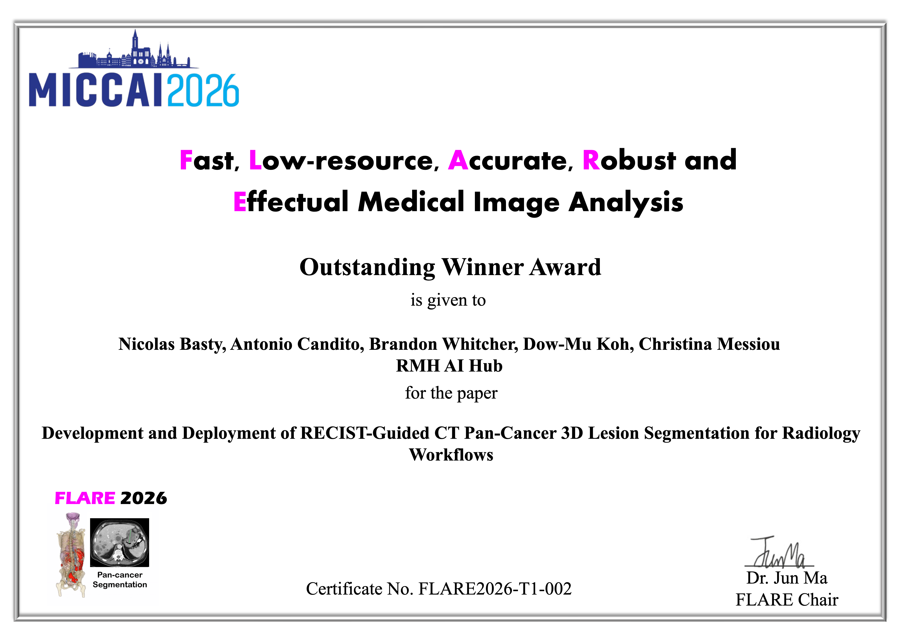</a> [2.png](https://raw.githubusercontent.com/Bardli/FLARE2026-images/main/FLARE26-awards/2.png) Outstanding Winner Award | Rmh_ai_hub | [Code](https://github.com/antoniocandito/Recist2Seg_OsiriXgrpc/) | [Development and Deployment of RECIST-Guided CT Pan-Cancer 3D Lesion Segmentation for Radiology Workflows](https://openreview.net/forum?id=2E53svXdTe) |
| <a href="FLARE26-awards/3.png">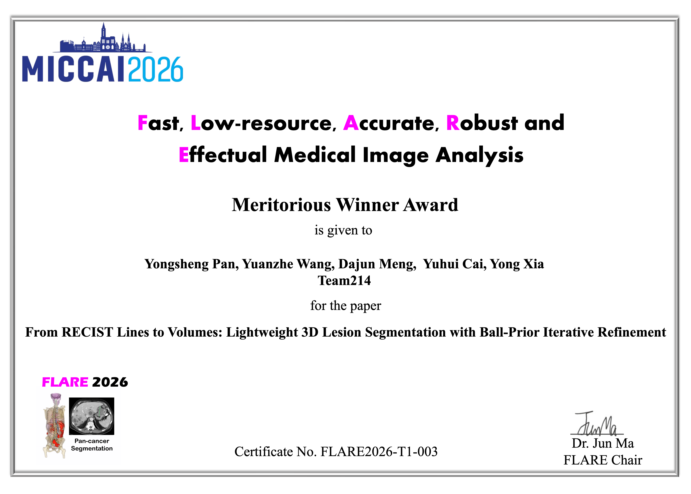</a> [3.png](https://raw.githubusercontent.com/Bardli/FLARE2026-images/main/FLARE26-awards/3.png) Meritorious Winner Award | team214 | [Code](https://github.com/YaliShanda985/MICCAI-FLARE-2026-Task1-Subtask2) | [From RECIST Lines to Volumes: Lightweight 3D Lesion Segmentation with Ball-Prior Iterative Refinement](https://openreview.net/forum?id=JYnUy4TNI5) |
| <a href="FLARE26-awards/4.png">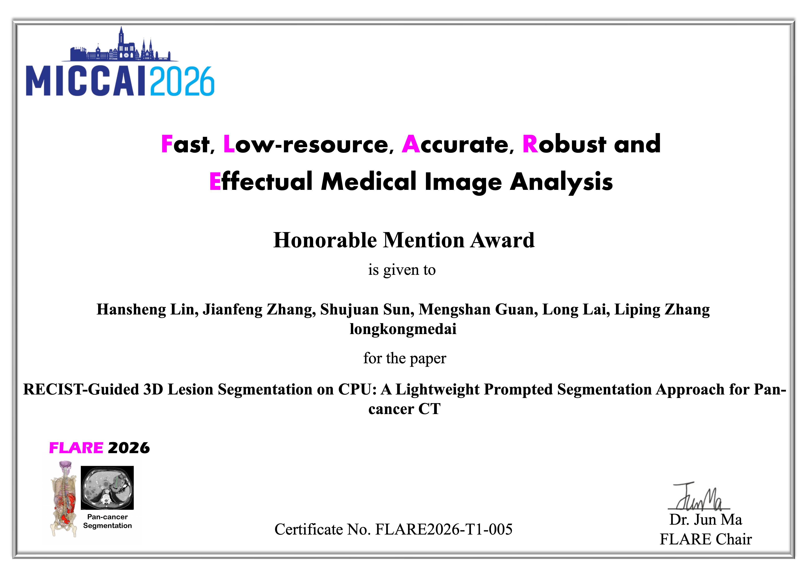</a> [4.png](https://raw.githubusercontent.com/Bardli/FLARE2026-images/main/FLARE26-awards/4.png) Honorable Mention Award | longkongmedai | [Code](https://github.com/B664577/flare26-t1-recist-seg) | [RECIST-Guided 3D Lesion Segmentation on CPU: A Lightweight Prompted Segmentation Approach for Pan-cancer CT](https://openreview.net/forum?noteId=tWeoPHX0Hl) |
| <a href="FLARE26-awards/5.png">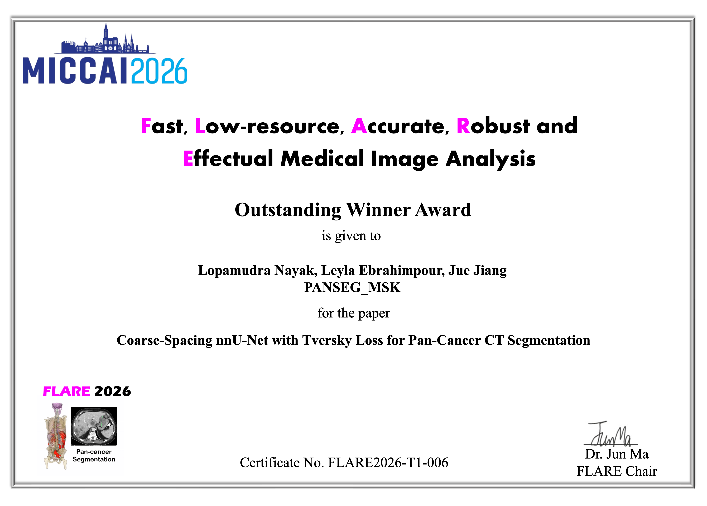</a> [5.png](https://raw.githubusercontent.com/Bardli/FLARE2026-images/main/FLARE26-awards/5.png) Outstanding Winner Award | PANSEG_MSK Submission: PANSEG_SPI26 | [Code](https://github.com/lophy95/PANSEG_SPI26/tree/main) | [Coarse-Spacing nnU-Net with Tversky Loss for Pan-Cancer CT Segmentation](https://openreview.net/forum?id=Os4tClciJv) |
|  [6.png](https://raw.githubusercontent.com/Bardli/FLARE2026-images/main/FLARE26-awards/6.png) Meritorious Winner Award | jehb4ik | [Code](https://github.com/Jehb4ik/PANTHER-FLARE2026) | [PANTHER: PAN-cancer CT Segmentation with Two-tier Healthy-scan Ensemble Rejection](https://openreview.net/attachment?id=w9f1fdcYIb&name=pdf) |
| <a href="FLARE26-awards/7.png">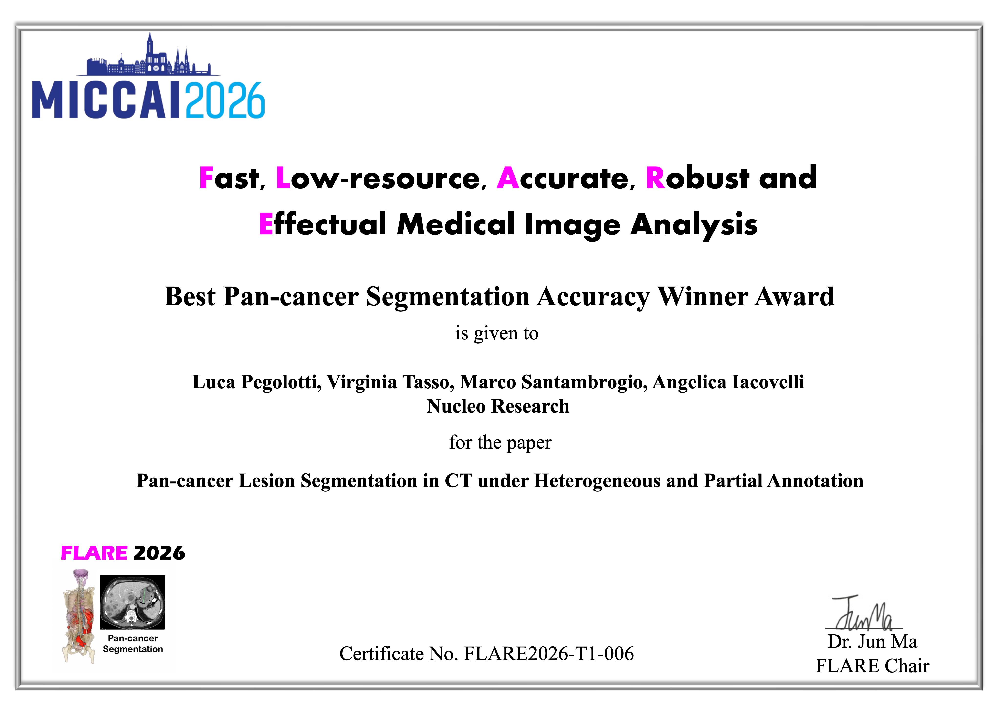</a> [7.png](https://raw.githubusercontent.com/Bardli/FLARE2026-images/main/FLARE26-awards/7.png) Best Pan-cancer Segmentation Accuracy Winner Award | Nucleo Research | [Code](https://github.com/Nucleo-Research/omnilesion) | [Pan-cancer Lesion Segmentation in CT under Heterogeneous and Partial Annotation](https://openreview.net/forum?id=q7GnjovcPJ) |
| <a href="FLARE26-awards/8.png">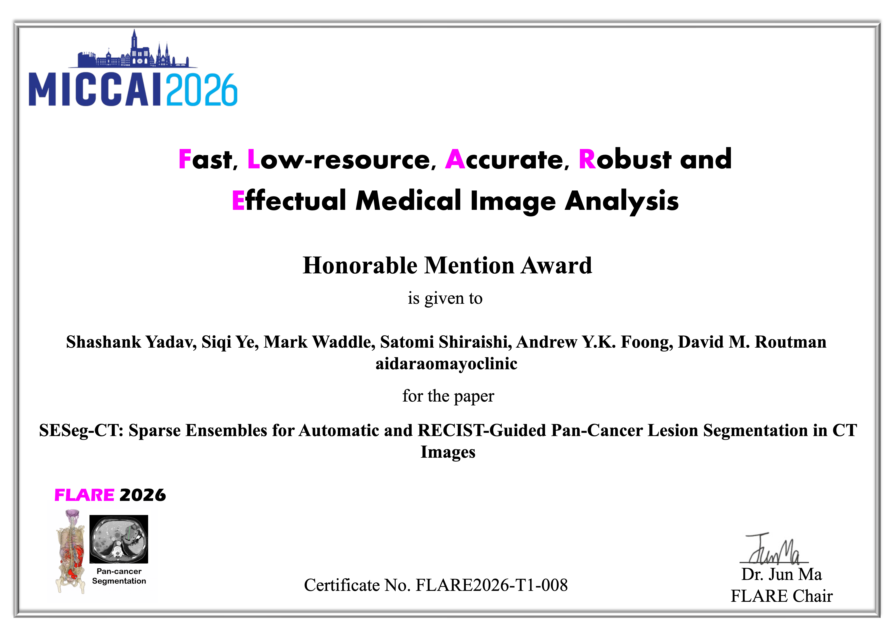</a> [8.png](https://raw.githubusercontent.com/Bardli/FLARE2026-images/main/FLARE26-awards/8.png) Honorable Mention Award | AIDA RAO Mayo Clinic | [Code](https://github.com/xinformatics/miccaiflare2026task1) | [SESeg-CT: Sparse Ensembles for Automatic and RECIST-Guided Pan-Cancer Lesion Segmentation in CT Images](https://openreview.net/forum?id=sbrp9WtYTl) |
|  [9.png](https://raw.githubusercontent.com/Bardli/FLARE2026-images/main/FLARE26-awards/9.png) Honorable Mention Award | Nucleo Research | [Code](https://github.com/Nucleo-Research/omnilesion) | [Pan-cancer Lesion Segmentation in CT under Heterogeneous and Partial Annotation](https://openreview.net/forum?id=q7GnjovcPJ) |

## Task 2

| Certificate | Team | Code | Paper |
| --- | --- | --- | --- |
| <a href="FLARE26-awards/10.png">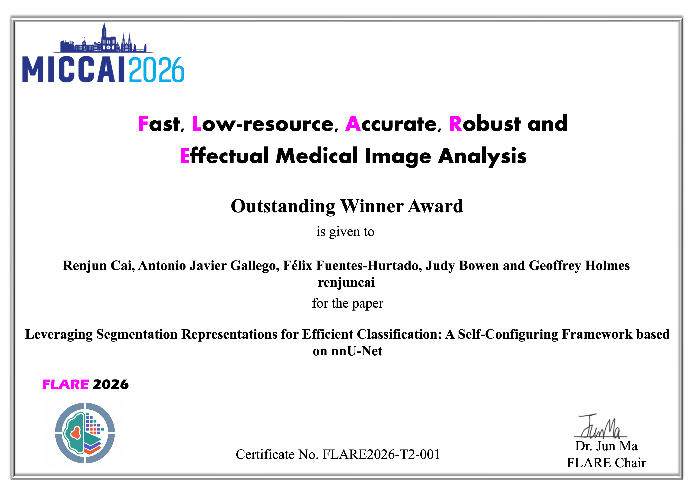</a> [10.png](https://raw.githubusercontent.com/Bardli/FLARE2026-images/main/FLARE26-awards/10.png) Outstanding Winner Award | renjuncai | [Code](https://github.com/cairenjun916-oss/FLARE2026TASK2) | [Leveraging Segmentation Representations for Efficient Classification: A Self-Configuring Framework based on nnU-Net](https://openreview.net/forum?id=QgYSRvGu9X) |
| <a href="FLARE26-awards/11.png">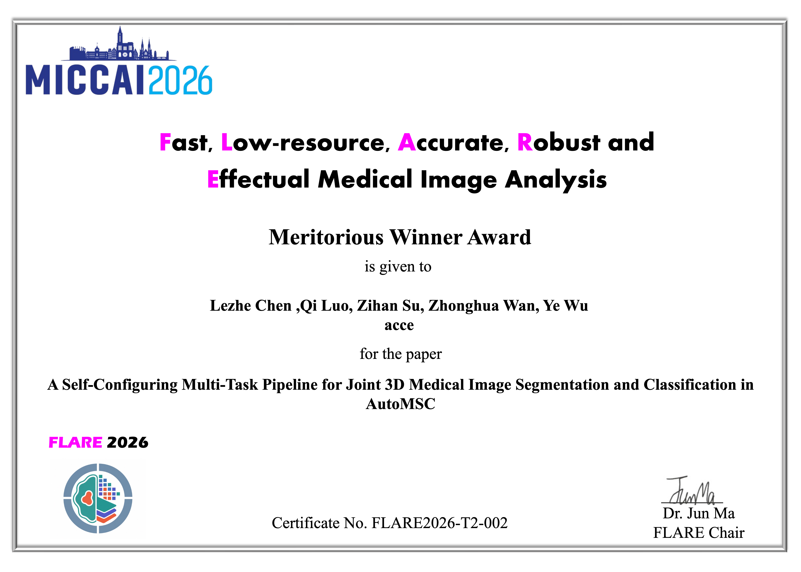</a> [11.png](https://raw.githubusercontent.com/Bardli/FLARE2026-images/main/FLARE26-awards/11.png) Meritorious Winner Award | acce | [Code](https://github.com/dowst111/AutoMSC-acce) | A Self-Configuring Multi-Task Pipeline for Joint 3D Medical Image Segmentation and Classification in AutoMSC [OpenReview group — individual paper link not provided](https://openreview.net/group?id=MICCAI.org/2026/Challenge/FLARE#tab-recent-activity) |
|  [12.png](https://raw.githubusercontent.com/Bardli/FLARE2026-images/main/FLARE26-awards/12.png) Meritorious Winner Award | TheFlares | [Code](https://github.com/hazrad-code/MICCAI-FLARE-2026-Task-2-AutoMSC-Challenge-by-Team-TheFlares) | [Evaluating Self-Configuring Multi-Task Learning for Joint Segmentation and Case-Level Classification of Heterogeneous 3D Medical Images](https://openreview.net/forum?id=tXb1bqy3vU) |
|  [13.png](https://raw.githubusercontent.com/Bardli/FLARE2026-images/main/FLARE26-awards/13.png) Honorable Mention Award | longkongmedai | [Code](https://github.com/B664577/flare26-t2-automsc) | [Self-Configured Joint Segmentation and Classification for Glioma MRI: A Class-Weighted Multi-Task nnU-Net Approach](https://openreview.net/forum?noteId=LtEDUhuTEn) |
| <a href="FLARE26-awards/14.png">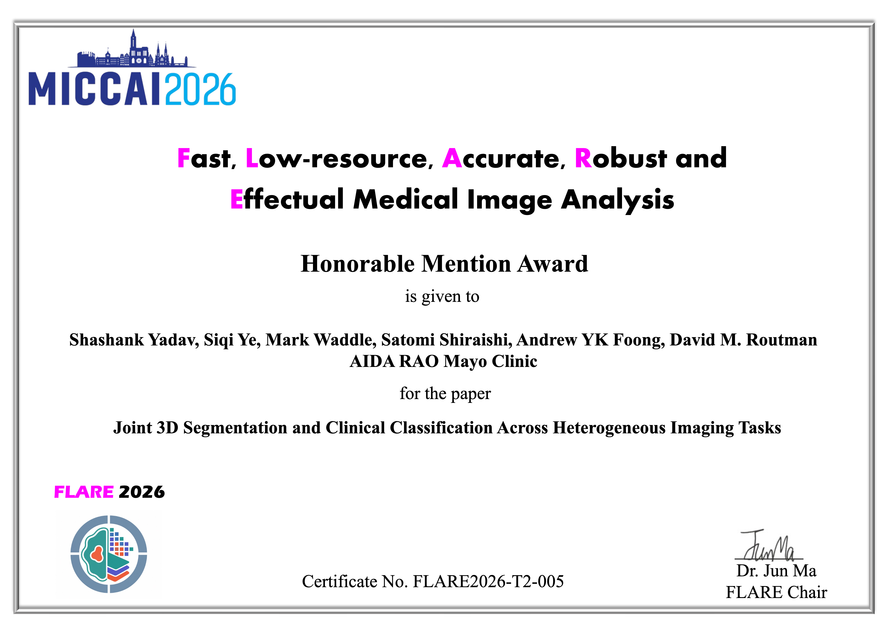</a> [14.png](https://raw.githubusercontent.com/Bardli/FLARE2026-images/main/FLARE26-awards/14.png) Honorable Mention Award | AIDA RAO Mayo Clinic | [Code](https://github.com/xinformatics/miccaiflare2026task2) | [Joint 3D Segmentation and Clinical Classification Across Heterogeneous Imaging Tasks](https://openreview.net/forum?id=WOPVwF7ccv) |

## Task 3

| Certificate | Team | Code | Paper |
| --- | --- | --- | --- |
| <a href="FLARE26-awards/15.png">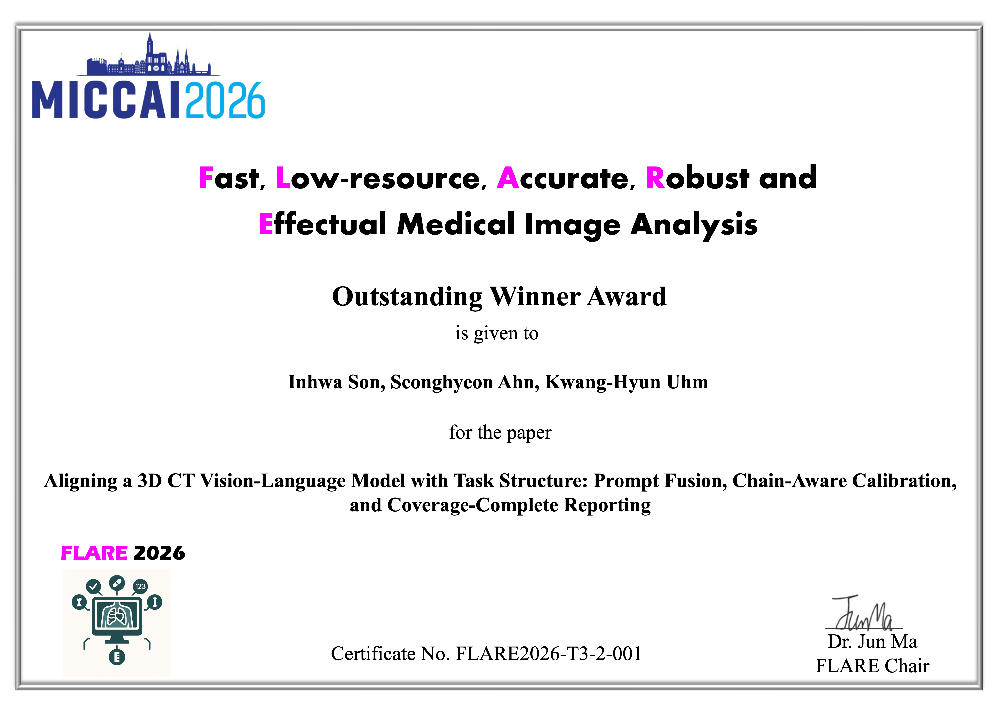</a> [15.png](https://raw.githubusercontent.com/Bardli/FLARE2026-images/main/FLARE26-awards/15.png) Outstanding Winner Award | AIMHI (3D) | [Code](https://github.com/hwm31/FLARE-2026-Task-3-3D-Team-AIMHI) | [Aligning a 3D CT Vision-Language Model with Task Structure: Prompt Fusion, Chain-Aware Calibration, and Coverage-Complete Reporting](https://openreview.net/forum?id=Kyz5l5KVIu&referrer=%5BAuthor%20Console%5D(%2Fgroup%3Fid%3DMICCAI.org%2F2026%2FChallenge%2FFLARE%2FAuthors%23your-submissions)) |
| <a href="FLARE26-awards/16.png">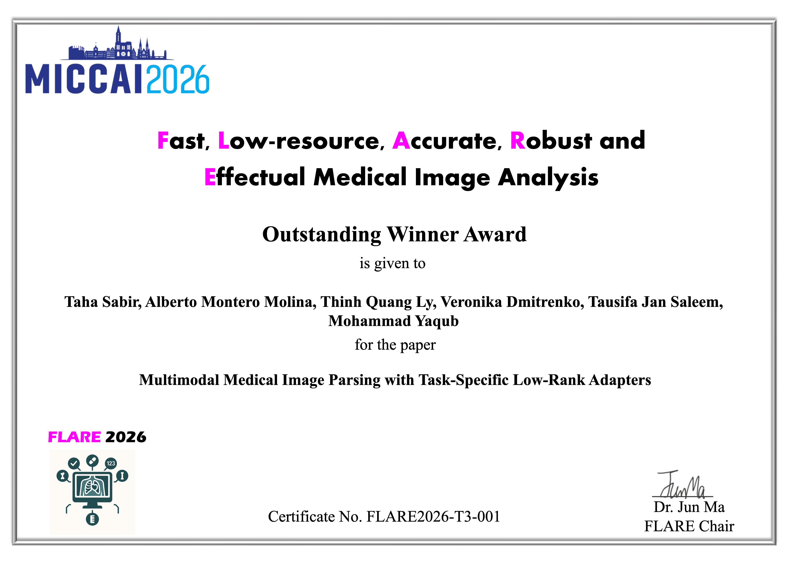</a> [16.png](https://raw.githubusercontent.com/Bardli/FLARE2026-images/main/FLARE26-awards/16.png) Outstanding Winner Award | Hexapus | [Code](https://github.com/TahaSabir0/FLARE26-Hexapus) | [Multimodal Medical Image Parsing with Task-Specific Low-Rank Adapters](https://openreview.net/forum?id=3i4CYnXhig&noteId=3i4CYnXhig) |
| <a href="FLARE26-awards/17.png">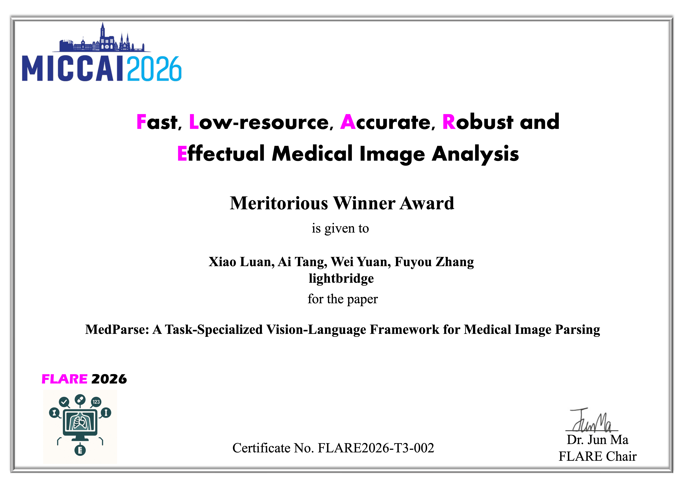</a> [17.png](https://raw.githubusercontent.com/Bardli/FLARE2026-images/main/FLARE26-awards/17.png) Meritorious Winner Award | lightbridge | [Code](https://github.com/tangaii/MedParse) | [MedParse: A Task-Specialized Vision-Language Framework for Medical Image Parsing](https://openreview.net/forum?id=ExW7VanPJs) |
| <a href="FLARE26-awards/18.png">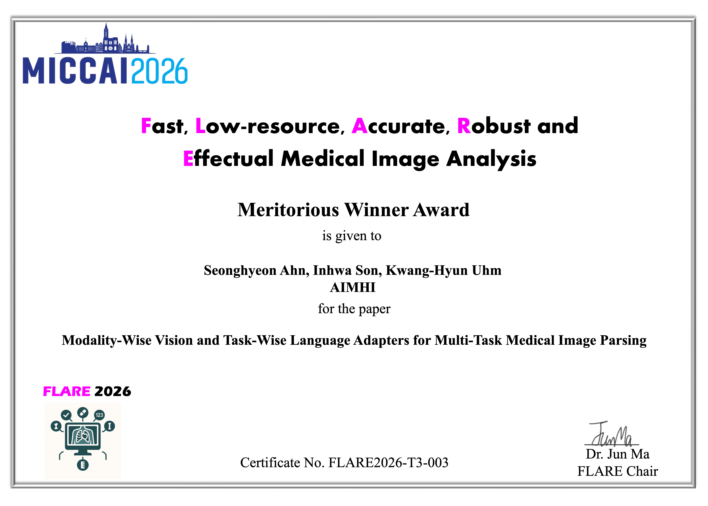</a> [18.png](https://raw.githubusercontent.com/Bardli/FLARE2026-images/main/FLARE26-awards/18.png) Meritorious Winner Award | AIMHI (2D) | [Code](https://github.com/BluG02/FLARE-2026-Task-3-2D-Team-AIMHI.git) | [Modality-Wise Vision and Task-Wise Language Adapters for Multi-Task Medical Image Parsing](https://openreview.net/forum?id=guQjhKJrvs&referrer=%5BAuthor%20Console%5D(%2Fgroup%3Fid%3DMICCAI.org%2F2026%2FChallenge%2FFLARE%2FAuthors%23your-submissions)) |
| <a href="FLARE26-awards/19.png">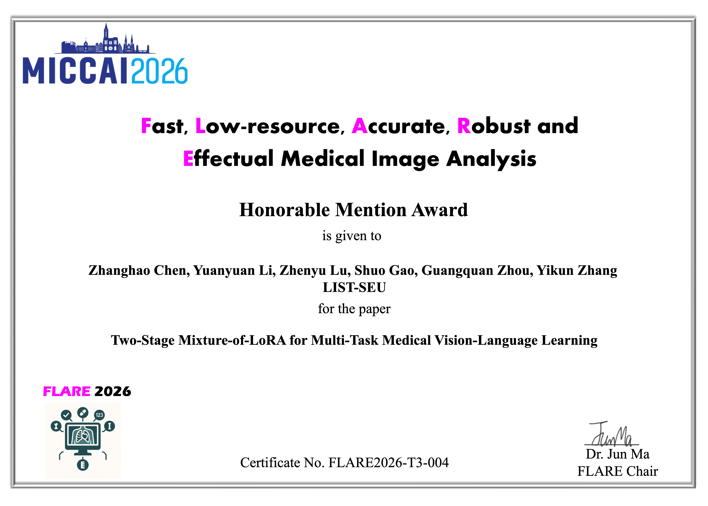</a> [19.png](https://raw.githubusercontent.com/Bardli/FLARE2026-images/main/FLARE26-awards/19.png) Honorable Mention Award | LIST-SEU | [Code](https://github.com/YuanYL03/MICCAI-FLARE-2026-Challenge-Task3-2D) | [Two-Stage Mixture-of-LoRA for Multi-Task Medical Vision-Language Learning](https://openreview.net/forum?id=TQRLbbhz7w&noteId=TQRLbbhz7w) |
|  [20.png](https://raw.githubusercontent.com/Bardli/FLARE2026-images/main/FLARE26-awards/20.png) Honorable Mention Award | Medcat | [Code](https://github.com/HuiLin0220/Medcat) | [Medcat: Task-Routed and Source-Selective Adaptation of a Single Medical Vision-Language Model](https://openreview.net/forum?id=nR9SL6kILL&noteId=nR9SL6kILL) |

## Matching notes

- `5.png`: the certificate names **PANSEG_MSK**, while the submission record names **PANSEG_SPI26**. The authors and paper title match.
- `11.png` (**acce**): the supplied OpenReview link is a challenge group page. A specific paper URL is still needed.
- `1.png` and `8.png` refer to the same Task 1 AIDA RAO Mayo Clinic submission; `7.png` and `9.png` refer to the same Nucleo Research submission. Each award is listed separately.
- AIMHI has separate Task 3 **3D** (`15.png`) and **2D** (`18.png`) submissions.

Machine-readable mappings: [awards.json](awards.json).
